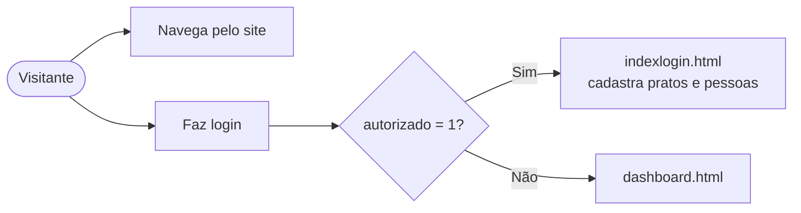
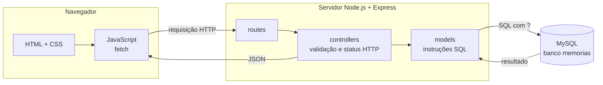
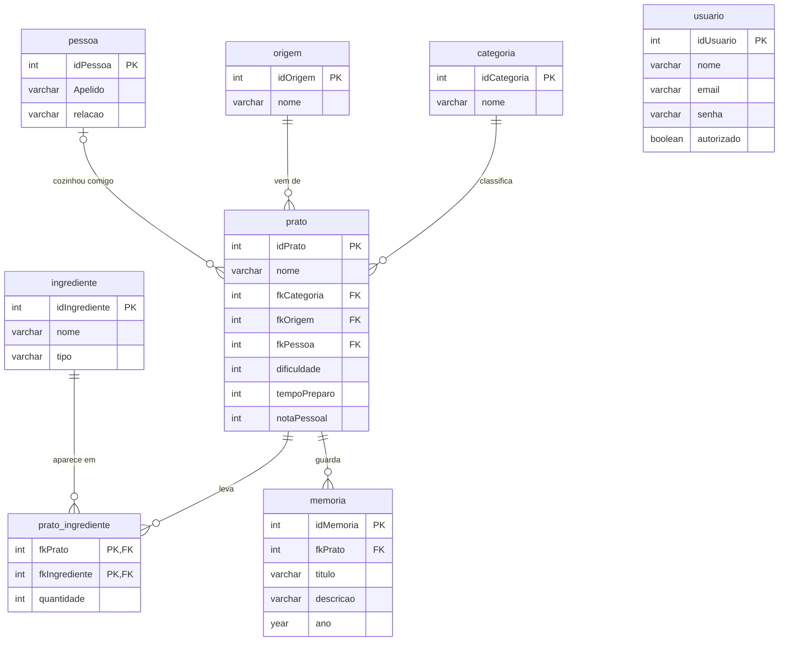

<div align="center">

# 🍽️ Memória no Prato

**Os pratos da minha vida, as pessoas que cozinharam comigo e as histórias que cada um carrega.**

Portfólio pessoal de gastronomia com banco de dados, API e dashboard.


Projeto individual da disciplina **Pesquisa e Inovação**<br>
Análise e Desenvolvimento de Sistemas · **São Paulo Tech School**

</div>

---

## 📑 Sumário

- [Sobre o projeto](#-sobre-o-projeto)
- [Funcionalidades](#-funcionalidades)
- [Páginas do site](#-páginas-do-site)
- [Controle de acesso](#-controle-de-acesso)
- [Arquitetura](#-arquitetura)
- [Banco de dados](#-banco-de-dados)
- [API](#-api)
- [Dashboard](#-dashboard)
- [Tecnologias](#-tecnologias)
- [Estrutura de pastas](#-estrutura-de-pastas)
- [Como executar](#-como-executar)
- [Decisões do projeto](#-decisões-do-projeto)
- [Próximos passos](#-próximos-passos)
- [Autor](#-autor)

---

## 📖 Sobre o projeto

A comida está ligada às pessoas, aos lugares e aos momentos que importam para mim, e essas lembranças costumam ficar espalhadas em fotos, conversas e na memória. O **Memória no Prato** reúne tudo em um só lugar: os pratos que fazem parte da minha vida, as pessoas ligadas a eles e as histórias que carregam.

O projeto junta duas coisas que eu amo, a gastronomia e a minha família, e conta quem eu sou e como a gastronomia entrou na minha vida.

> 💬 *O dashboard responde quatro perguntas: **o que** eu cozinho, **com o quê**, **com quem** e **desde quando**.*

---

## ✨ Funcionalidades

| | Funcionalidade | Descrição |
|---|---|---|
| 🍲 | **Pratos** | Cartões com categoria, origem, dificuldade, tempo de preparo e nota em estrelas, vindos do banco |
| 👵 | **Pessoas** | Quem cozinhou comigo, por apelido e relação |
| 📜 | **Memórias** | As histórias de cada prato, em ordem cronológica |
| 📊 | **Dashboard** | 4 indicadores e 4 gráficos em Chart.js, calculados direto do banco |
| 🧭 | **Sobre mim** | Minha trajetória na cozinha, em uma linha do tempo |
| 🔐 | **Cadastro e login** | Criação de conta com validação de senha forte e login com sessão |
| ✍️ | **Cadastro de pratos e pessoas** | Só para usuários autorizados, com a autorização conferida no servidor |

---

## 🗺️ Páginas do site

| Página | Arquivo | Acesso |
|---|---|---|
| Início | `index.html` | Público |
| Sobre mim | `sobremim.html` | Público |
| Pratos | `pratos.html` | Público |
| Pessoas | `pessoas.html` | Público |
| Memórias | `memorias.html` | Público |
| Dashboard | `dashboard.html` | Público |
| Entrar | `entrar.html` | Público |
| Cadastro | `cadastro.html` | Público |
| Início do autorizado | `indexlogin.html` | Só autorizados |
| Cadastrar prato | `cadastroPratos.html` | Só autorizados |
| Cadastrar pessoa | `cadastroPessoas.html` | Só autorizados |

<!-- Para mostrar as telas, salve os prints em uma pasta "docs/" e descomente:

-->

---

## 🔐 Controle de acesso

Qualquer pessoa navega pelo site. Só usuários **autorizados** cadastram pratos e pessoas.



- A autorização é dada direto no banco: `UPDATE usuario SET autorizado = TRUE WHERE email = '...';`
- O front guarda a sessão no `sessionStorage`, mas **o back-end confere a autorização no banco a cada cadastro**, porque o `sessionStorage` pode ser alterado por quem usa o navegador. Quem não é autorizado recebe **403**.

---

## 🏗️ Arquitetura

O projeto usa o template **web-data-viz** da SPTech, com o padrão **rotas → controllers → models**.



| Camada | O que faz | Exemplo |
|---|---|---|
| **routes** | Liga a URL à função certa | `GET /memorias/listar` |
| **controllers** | Valida os dados e escolhe o status da resposta (200, 400, 403, 409, 500) | `memoriasController.listar` |
| **models** | Monta e executa o SQL | `SELECT ... FROM memoria JOIN prato ...` |
| **config.js** | Abre a conexão e roda o SQL com parâmetros | `database.executar(instrucao, parametros)` |

---

## 🗄️ Banco de dados

Banco **MySQL** chamado `memorias`, com 8 tabelas. O script completo (tabelas e dados de teste) está em [`Banco de dados/banco.sql`](Banco%20de%20dados/banco.sql), e o DER do MySQL Workbench está em [`Banco de dados/DER.mwb`](Banco%20de%20dados/DER.mwb).



| Tabela | Guarda |
|---|---|
| `categoria` | Tipos de comida (massas, churrasco, doces...) |
| `origem` | De onde o prato vem |
| `pessoa` | Quem cozinhou comigo, só por apelido e relação |
| `prato` | O prato, com dificuldade e nota de 1 a 5 (garantidas por `CHECK`) |
| `ingrediente` e `prato_ingrediente` | Quais ingredientes cada prato leva (N:N) |
| `memoria` | A história ligada a cada prato, com o ano em que aconteceu |
| `usuario` | Contas de login e a coluna `autorizado` |

---

## 🔌 API

Todas as rotas respondem em JSON.

| Método | Rota | O que faz |
|---|---|---|
| `GET` | `/pratos/listar` | Lista os pratos com categoria e origem |
| `GET` | `/pratos/categorias` | Lista as categorias (para o `<select>` do cadastro) |
| `GET` | `/pratos/origens` | Lista as origens (para o `<select>` do cadastro) |
| `POST` | `/pratos/cadastrar` | Cadastra um prato (**só autorizados**) |
| `GET` | `/pessoas/listar` | Lista as pessoas |
| `POST` | `/pessoas/cadastrar` | Cadastra uma pessoa (**só autorizados**) |
| `GET` | `/memorias/listar` | Lista as memórias, da mais antiga à mais recente |
| `POST` | `/usuarios/cadastrar` | Cria uma conta |
| `POST` | `/usuarios/autenticar` | Faz o login (devolve id, nome, e-mail e autorização, nunca a senha) |
| `GET` | `/dashboard/kpis` | Os 4 indicadores |
| `GET` | `/dashboard/categorias` | Pratos por categoria |
| `GET` | `/dashboard/ingredientes` | Os 8 ingredientes mais usados |
| `GET` | `/dashboard/memoriasPessoas` | Memórias por pessoa |
| `GET` | `/dashboard/memorias` | Memórias por ano |

---

## 📊 Dashboard

**Indicadores (KPIs)**

| Indicador | Mostra |
|---|---|
| 🍽️ Pratos cadastrados | Quantos pratos fazem parte da minha história |
| ⭐ Nota média | A média das minhas notas, de 1 a 5 |
| 📜 Memórias | Quantas memórias estão registradas |
| 👥 Pessoas | Quantas pessoas cozinharam comigo |

**Gráficos (Chart.js)**

| Gráfico | Tipo | Pergunta que responde |
|---|---|---|
| Pratos por categoria | Barras deitadas | **O que** eu cozinho? |
| Ingredientes mais usados | Barras deitadas (top 8, sem temperos e óleo) | **Com o quê** eu cozinho? |
| Quem está nas minhas memórias | Barras em pé | **Com quem** eu cozinho? |
| Minha trajetória em memórias | Linha em degraus, com o total acumulado por ano | **Desde quando** eu cozinho? |

---

## 🛠️ Tecnologias

| Camada | Tecnologia |
|---|---|
| Front-end | HTML, CSS e JavaScript puro |
| Back-end | Node.js com Express (template web-data-viz da SPTech) |
| Banco de dados | MySQL, em uma máquina virtual Linux |
| Gráficos | Chart.js |
| Fontes | Lora e Outfit (Google Fonts) |
| Planejamento | Trello |
| Versionamento | Git e GitHub |

---

## 📁 Estrutura de pastas

```
Memorias-no-prato/
├── Banco de dados/
│   ├── banco.sql            # tabelas + dados de teste
│   └── DER.mwb              # diagrama do banco (MySQL Workbench)
└── web-data-viz/
    ├── app.js               # sobe o servidor e registra as rotas
    ├── .env.exemplo         # modelo das variáveis de ambiente
    ├── package.json
    ├── public/              # tudo o que o navegador recebe
    │   ├── *.html           # as páginas do site
    │   ├── css/             # um CSS geral + um por página
    │   ├── js/              # um JS por página + sessao.js
    │   └── assets/          # favicon e imagens
    └── src/
        ├── routes/          # URLs da API
        ├── controllers/     # validações e respostas
        ├── models/          # instruções SQL
        └── database/
            └── config.js    # conexão com o MySQL
```

---

## 🚀 Como executar

### Pré-requisitos

- [Node.js](https://nodejs.org/) (versão LTS)
- [MySQL](https://dev.mysql.com/downloads/) (com o MySQL Workbench, se quiser uma interface gráfica)
- [Git](https://git-scm.com/)

### 1. Clone o repositório

```bash
git clone https://github.com/Nickolas-Merola/Memorias-no-prato.git
cd Memorias-no-prato
```

### 2. Crie o banco de dados

Rode o script `Banco de dados/banco.sql` no MySQL. Ele cria o banco `memorias`, as tabelas e os dados de teste.

```bash
mysql -u root -p < "Banco de dados/banco.sql"
```

> No MySQL Workbench, abra o arquivo e execute tudo (⚡).
> O script começa com `DROP DATABASE IF EXISTS memorias;`, então pode ser rodado de novo sempre que quiser voltar ao banco original. **Atenção:** isso apaga tudo o que foi cadastrado pelo site.

### 3. Configure o ambiente

```bash
cd web-data-viz
cp .env.exemplo .env.dev
```

Abra o `.env.dev` e coloque o usuário e a senha do **seu** MySQL em `DB_USER` e `DB_PASSWORD`.

### 4. Instale as dependências e rode

```bash
npm install
npm start
```

Acesse **http://localhost:3333** 🎉

### 5. Entre como usuário autorizado

O banco de teste já tem um usuário **autorizado**: `teste@teste.com`, senha `teste123`. Com ele, dá para cadastrar pratos e pessoas.

Uma conta criada pela página de cadastro começa **sem** autorização. Para liberar, rode no MySQL:

```sql
UPDATE usuario SET autorizado = TRUE WHERE email = 'email@da.conta';
```

### Problemas comuns

| Erro | Causa provável |
|---|---|
| `AMBIENTE NÃO CONFIGURADO` | O arquivo `.env.dev` não existe ou está fora da pasta `web-data-viz` |
| `Access denied for user` | Usuário ou senha do MySQL errados no `.env.dev` |
| `Unknown database 'memorias'` | O `banco.sql` ainda não foi executado |
| `Cannot find module` | Faltou rodar `npm install` |

---

## 🧠 Decisões do projeto

- **SQL sempre com parâmetros (`?`)**: os valores vão separados da instrução, o que protege contra SQL Injection.
- **Autorização conferida no servidor**: o front pode ser alterado, então o back-end consulta o banco antes de cada cadastro.
- **Validação nas duas pontas**: o JavaScript da página avisa o usuário na hora, e o controller valida de novo antes de gravar.
- **Senha forte no cadastro**: mínimo de 8 caracteres, com maiúscula, minúscula, número e caractere especial.
- **Senha sem criptografia, por escopo**: em um sistema real, a senha seria guardada com hash (por exemplo, bcrypt).
- **Privacidade**: este repositório é público, então as pessoas aparecem só por apelido e relação, sem dados pessoais de terceiros.

---

## 🔭 Próximos passos

- [ ] Fotos dos pratos nos cartões
- [ ] Mostrar os ingredientes de cada prato
- [ ] Cadastro de memórias pelo site
- [ ] Senhas com hash

---

## 👨‍🍳 Autor

**Nickolas Merola da Silva**<br>
Análise e Desenvolvimento de Sistemas · São Paulo Tech School

<div align="center">

*Feito com carinho, e muita dedicação!* 🍲

</div>